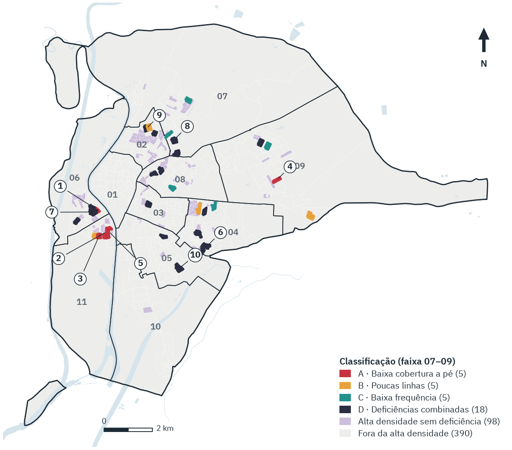

# Territorial inequality in urban bus service in Seville, Spain

**[Versão em português](README.pt.md)** · **Portfolio page:** https://gabrielloubarboza.github.io/en/projects/sevilha/

Which census sections of Seville combine **high population density** with **relatively insufficient urban bus
service**, and what does the shortfall consist of in each case? Service is measured in three separate dimensions:
a served stop within 400 m along the pedestrian network, the number of distinct lines, and scheduled departures per
hour without counting the same trip twice.

Author: **Gabriel Barboza Lourenço** · PostgreSQL/PostGIS · Python (OSMnx, NetworkX, GeoPandas) · GTFS · QGIS/PyQGIS

<p align="center"></p>

## Data

| Source | Use | Date |
|---|---|---|
| INE — Censo Anual de Población (table 69258) | official population by section (686,741) | 1 Jan 2024 |
| INE — census sections (SECC_CE_20240101) | 521 sections, area, density (EPSG:25830) | 1 Jan 2024 |
| IECA — population grid 250 m (`grid:gridp_250`) | approximate residence location (887 cells) | 1 Jan 2024 |
| TUSSAM GTFS — Spain's National Access Point (Powered by MITRAMS) | stops, lines, trips, schedules | version 20260928 |
| OpenStreetMap (OSMnx) | pedestrian network, rivers, railways, motorways | 25 Oct 2026 |
| IDE Sevilla — TUSSAM layers | **local quality control only** (redistribution prohibited) | 20 Oct 2026 |

Scope: TUSSAM urban buses on a reference weekday (21 Oct 2026), periods 07–09, 12–14 and 17–19. Metro, tram,
commuter rail and metropolitan buses are not included; punctuality and demand are not measured.

## Main results

| Indicator | Value |
|---|---:|
| Population with a served stop within 400 m on foot | **94.36%** (645,680; average walk 209 m) |
| Population without a stop within 400 m | 38,379 (5.61%) |
| Lines within reach, morning peak (average resident) | 3.55 |
| Accessible departures per hour, morning → afternoon | 29.8 → 25.2 (**−15.5%**) |
| High-density sections (top quartile, ≥ 30,976.8 inh./km²) | 131 (163,874 inhabitants) |
| **Priority sections** (high density + ≥ 1 relative deficiency) | **33 (41,208 inhabitants, 6.0%)** |
| … of which few lines **and** low frequency (type D) | 18 |

Low frequency in priority sections is structural: 22 of the 23 with low morning frequency keep it in all three
periods. Missing stops (type A) cluster in Los Remedios and Triana; weak service (types B–D) in Cerro-Amate, Triana,
Norte, Este-Alcosa-Torreblanca, San Pablo-Santa Justa, Macarena and Sur.
Tables: `resultados/etapa2/sintese_municipal.csv`, `resultados/etapa4/sintese_municipal.csv`,
`resultados/etapa4/sintese_tipologia.csv`, `resultados/etapa4/ranking_prioritarias.csv`.

## Repository layout

```
config/            config.yaml (all parameters and sources; reconstructed — see "Reproduce")
scripts/           01–22 pipeline, comum.py, rede_acessibilidade.py, visual.py, executar_etapa1–5.ps1
sql/               00 database, 01–04 sources and QA, 05–08 accessibility, 09–12 scheduled service, 13–14 diagnosis
data/              manifesto_fontes.json (URLs, versions, hashes); processed/*.json load counts and GTFS inspection
resultados/        etapa2–4 CSV tables and charts (GeoPackages of intermediate stages not versioned)
produtos/          sevilla_oferta_bus.qgz, two final GeoPackages, figures (ES and figuras_pt/)
assets/fonts/      IBM Plex Sans (SIL OFL 1.1)
docs/              methodology (stages 1–4), tests, sources, GTFS notes, data licences, highlighted code
```

## GeoPackages (EPSG:25830, ETRS89 / UTM 30N)

| File | Layers | Licence |
|---|---|---|
| `produtos/sevilla_oferta_bus_resultados.gpkg` | sections with all indicators (521), priority sections (33), districts (11), municipal boundary (dissolved INE sections), IECA cells (887), demand points (2,674), GTFS bus stops (1,043), regional context; field dictionary and layer metadata | INE (cite source), IECA CC BY 4.0, "Powered by MITRAMS" |
| `produtos/sevilla_oferta_bus_contexto_osm.gpkg` | pedestrian network (47,443), barrier polygons and lines | **ODbL 1.0** |

## Reproduce

Requirements: PostgreSQL + PostGIS, Python 3.12+ (`requirements.txt`; exact versions in `requirements-lock.txt`),
QGIS 3.40 LTR for the QGIS project and styles.

```powershell
python -m venv .venv; .venv\Scripts\pip install -r requirements.txt
psql -U postgres -v owner=gis_portfolio -f sql\00_criar_banco.sql   # then add the password to your pgpass (manual)
powershell -File scripts\executar_etapa1.ps1    # downloads, OSM network, load, integrity tests
powershell -File scripts\executar_etapa2.ps1    # 400 m walking access
powershell -File scripts\executar_etapa3.ps1    # scheduled service from GTFS
powershell -File scripts\executar_etapa4.ps1    # density, thresholds, typology, ranking
```

**Important notes**
- `config/config.yaml` was **missing from the project archive** and was reconstructed from the parameters the
  original run stored in the database (`prep.parametros`, `analise.parametros`, `prep.periodos_analise`) and from
  `data/manifesto_fontes.json`; each value is annotated with its evidence. The stage 2, 3 and 4 test scripts (08, 11,
  14) were run with it against the original database on 27 Oct 2026.
- `config/paleta.json` (colour palette used by `visual.py`, `16_geopackages_finales.py`, `17_figuras.py`,
  `18_informe_pdf.py` and the QGIS style scripts) is **also missing** and could not be recovered, so **stage 5
  (final GeoPackage styling, figures, report) cannot be rerun** from this repository. The published GeoPackages and
  figures are the original stage 5 outputs.
- The TUSSAM GTFS on the National Access Point needs an API key; the pipeline uses the public Mobility Database
  mirror with a versioned URL and an MD5 check. The IDE Sevilla layers are downloaded for local QA only.
- Online sources change: a new run reflects the data available on that date.

## Limitations

- Scheduled service only (GTFS), not real punctuality or ridership; 77% of stop times are interpolated (±2 min
  sensitivity changes mean frequency by < 0.5%).
- City-internal relative thresholds, not technical or legal standards; some sections with severe deficiencies and
  mid-range density fall outside the 33.
- IECA grid population differs from INE totals by section; density uses each section's total area.
- OSM network without explicit sidewalks; motorways without pedestrian crossings excluded.

## Licence

Original code — [MIT](LICENSE), © 2026 Gabriel Barboza Lourenço (code only). Data, derived tables, GeoPackages and
figures follow each source's terms — see [`docs/licencias_datos.md`](docs/licencias_datos.md). IBM Plex: SIL OFL 1.1.
